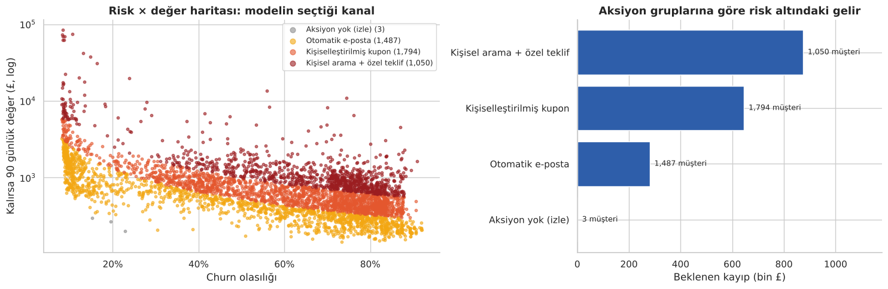
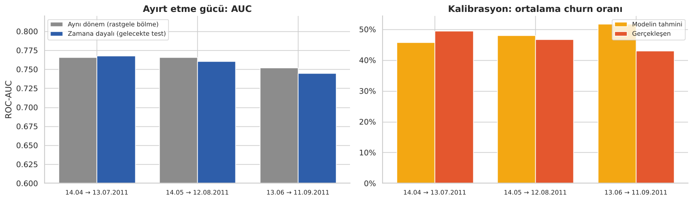
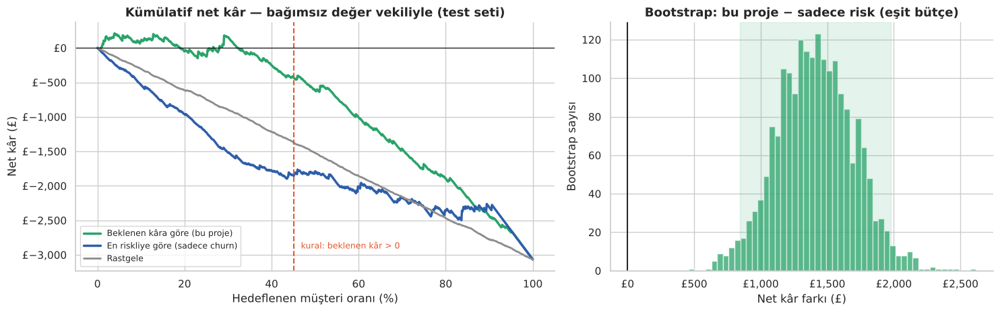
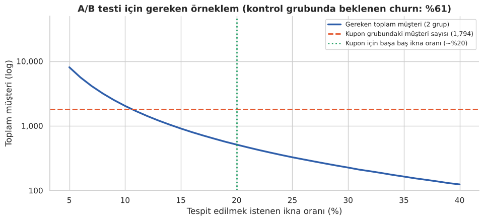
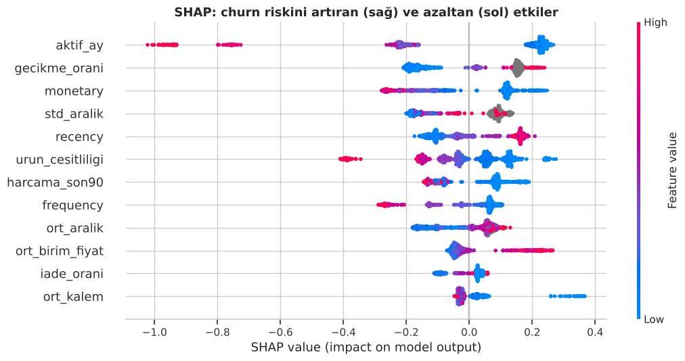
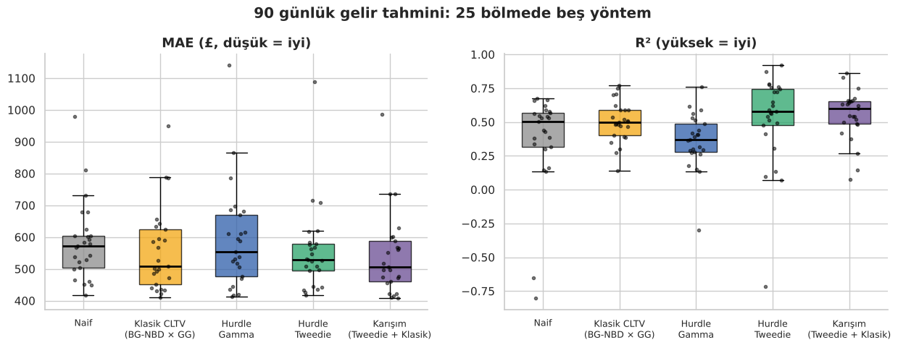

# 🛒 Müşteri Kaybı Tahmini, Müşteri Değeri ve Kampanya Optimizasyonu

<p align="center">
  
  
  
  
  
</p>

<p align="center">
  <a href="https://nbviewer.org/github/Memreu/Customer-Churn-and-Value-Prediction/blob/main/musteri_kaybi_ve_deger.ipynb"></a>
  <a href="https://colab.research.google.com/github/Memreu/Customer-Churn-and-Value-Prediction/blob/main/musteri_kaybi_ve_deger.ipynb"></a>
</p>

Uçtan uca bir e-ticaret müşteri zekâsı projesi: **kim gidecek**, **giderse ne kaybederiz** ve **kampanya bütçesini kime, hangi kanalla harcamalıyız** sorularını tek bir akışta cevaplıyor.

Klasik RFM ve CLTV analizleri müşterinin *bugün* nerede olduğunu anlatır. Bu proje bir adım ileri gidiyor: **geleceği tahmin ediyor**, tahmini **paraya çeviriyor** ve sonuçlarını **güven aralıklarıyla** raporluyor.

<p align="center"></p>

> 🇬🇧 **In English:** An end-to-end customer intelligence project on ~540K e-commerce transactions. It predicts **who will churn** in the next 90 days (LightGBM, AUC ≈ 0.75, validated out-of-time), **how much revenue is at risk** (hurdle model blended with classic BG-NBD × Gamma-Gamma CLTV, R² 0.55), and **which retention channel maximises expected profit** for each customer. Results are reported with a locked test set, bootstrap confidence intervals, seasonal recalibration and an A/B test power analysis.

<details>
<summary><b>📑 İçindekiler</b></summary>

- [Öne çıkan sonuçlar](#öne-çıkan-sonuçlar)
- [Doğrulama yaklaşımı](#doğrulama-yaklaşımı)
- [Temel bulgular](#temel-bulgular)
- [Model geliştirme süreci](#model-geliştirme-süreci)
- [Proje akışı](#proje-akışı)
- [Kurulum ve çalıştırma](#kurulum-ve-çalıştırma)
- [Klasör yapısı](#klasör-yapısı)
- [Veri](#veri)
- [Sınırlılıklar ve sonraki adımlar](#sınırlılıklar-ve-sonraki-adımlar)

</details>

## Öne çıkan sonuçlar

| | Sonuç |
|---|---|
| 🎯 **Churn modeli** | LightGBM, kilitli test setinde ROC-AUC 0.74 / PR-AUC 0.65; **zamana dayalı geriye dönük testlerde 0.745–0.768** |
| 💷 **Değer modeli** | Hurdle (churn × Tweedie) ile klasik BG-NBD × Gamma-Gamma CLTV'nin karışımı, **R² 0.55**. Tek başına: hurdle 0.52, klasik CLTV 0.50, naif yöntem 0.37 |
| 📈 **Hedefleme** | Eşit bütçeyle risk × değer kuralı, sadece riske göre hedeflemekten **+£1.406 daha fazla kâr** (%95 GA: £841 – £1.976), modelden bağımsız bir değer ölçüsüyle |
| 🌦️ **Mevsim kalibrasyonu** | Sıralamayı bozmadan olasılıkları düzeltiyor; geriye dönük testte Brier 0.208 → 0.200 |
| 🧪 **A/B test tasarımı** | Kupon grubundaki ~1.800 müşteri, %15 ve üzeri ikna oranını ölçmeye yetiyor |
| 📋 **Çıktı** | 4.334 müşteri için mevsime göre kalibre churn olasılığı, risk altındaki değer, ana risk nedeni (SHAP) ve **beklenen kârı en yüksek iletişim kanalı** |

## Doğrulama yaklaşımı

Bu projede sonuçların inandırıcılığı, modelin kendisi kadar önemli. Bu yüzden:

- 🔒 **Kilitli test seti.** Test müşterileri en başta ayrıldı. Hiperparametre seçimi, model kıyasları ve değer modeli seçimi yalnızca eğitim setinde, 5×5 tekrarlı çapraz doğrulamayla yapıldı. Test seti en sonda **bir kez** açıldı.
- ⏳ **Zamana dayalı geriye dönük test.** Model bir dönemde eğitilip hedef penceresi bittikten sonraki dönemde test edildi (3 farklı dönem). Böylece modelin sadece aynı dönemde değil, **gelecekte** de çalıştığı gösterildi.
- 🔁 **Döngüsellikten arındırılmış kampanya değerlendirmesi.** Stratejiler değer modeliyle sıralanıp yine değer modeliyle puanlanmadı. Kurtarılan müşterinin değeri, modelden **bağımsız** bir vekille (geçmiş harcama hızı) ölçüldü.
- ⚖️ **Eşit bütçe ve bootstrap.** Stratejiler aynı sayıda müşteriyle kıyaslandı ve test seti 2.000 kez yeniden örneklenerek **%95 güven aralıkları** hesaplandı.

<p align="center"></p>

## Temel bulgular

1. **Süreklilik en güçlü koruyucu.** Modelin en önemli özelliği müşterinin kaç farklı ayda alışveriş yaptığı. Ne kadar harcadığından çok, ne kadar **düzenli** geldiği önemli.
2. **Kişisel ritim, sabit kuraldan iyidir.** Kendi alışveriş aralığının yaklaşık 3 katı süre sessiz kalan müşteri net biçimde riskli bölgeye geçiyor.
3. **Hedefleme kuralının üstünlüğü sağlam, kampanyanın mutlak kârlılığı ise değil.** Risk × değer kuralı her değerlendirmede ve 2.000 bootstrap örneğinin tamamında daha iyi. Ama muhafazakâr değer ölçüsüyle £10'luk kupon kampanyası en iyi hedeflemeyle bile yaklaşık başa baş; kârlılık gerçek ikna oranına bağlı ve **A/B testiyle doğrulanmalı**.
4. **Ucuz kanallar her koşulda kârlı.** Duyarlılık analizine göre müşteri başına £1–5'lik kanallar makul her ikna oranında kâr getiriyor; pahalı kupon için ikna oranı en az ~%20 olmalı. Bu yüzden final karar mantığı her müşteriye kendi değerine uygun maliyette bir kanal seçiyor.
5. **Model zamanda genelleşiyor ama kalibrasyonu mevsime göre kayıyor.** Yazdan eğitilen model yılbaşı sezonunda churn'ü ~9 puan fazla tahmin ediyor. Log-odds kaydırmasıyla yapılan mevsim kalibrasyonu, sıralamayı bozmadan bu kaymayı düzeltiyor ve hedef oran 5 puan hatalı olsa bile fayda sağlıyor. Kaydırma miktarı, geçen yılın aynı dönemindeki "taze müşteri" kohortundan tahmin ediliyor.
6. **Değer tahmininde kayıp fonksiyonu kritik, birleştirmek daha da iyi.** Gamma'dan Tweedie'ye geçmek R²'yi 0.36'dan 0.52'ye çıkardı; klasik CLTV ile ortalamak ise 0.55'e. Kampanya kararı, "kalırsa değeri" ayrıca verebildiği için hurdle modeli kullanıyor.
7. **BG-NBD kısa veride müşteri kaybını göremiyor.** 9 aylık gözlemde kayıp parametreleri sıfıra iniyor ve model herkesi aktif sayıyor.
8. **Kampanyanın gerçek etkisi ölçülebilir.** Güç analizine göre kupon grubu, başa baş noktası (~%20) çevresindeki ikna oranlarını bir A/B testiyle güvenilir şekilde ölçmeye yetiyor; %10 gibi küçük etkiler için ise havuz yetmiyor.

<p align="center">
  
</p>
<p align="center">
  
</p>

## Model geliştirme süreci

| Deney | Sonuç |
|---|---|
| Hiperparametre ayarı (sığ ağaç, düşük öğrenme hızı) | ✅ +0.027 AUC (eğitim CV), 25/25 bölmede daha iyi |
| Değer modelinde Tweedie kaybı | ✅ R² 0.36 → 0.52 |
| Hurdle + klasik CLTV karışımı | ✅ R² 0.52 → 0.55 |
| Mevsim kalibrasyonu (log-odds kaydırması) | ✅ Brier 0.208 → 0.200, AUC değişmeden |
| Çok kanallı karar mantığı | ✅ Keyfi eşikler yerine tek ekonomik kural |
| 8 yeni davranışsal özellik | ➖ Fark yok |
| Monoton kısıtlar | ➖ Fark yok |
| LightGBM + lojistik regresyon ensemble | ➖ Fark yok |
| 9 kesim tarihiyle eğitim (veriyi 8 kat artırma) | ➖ Mevsimler karıştığı için daha kötü |
| BG-NBD / Gamma-Gamma özellikleri | ➖ Fark yok (bilgi mevcut özelliklerde zaten var) |
| Ürün zevk profili (TF-IDF + SVD) | ➖ Fark yok |

<p align="center">
  
  
</p>

## Proje akışı

| # | Bölüm | Teknik |
|---|---|---|
| 1 | Veri temizleme | İadeler, eksik ID'ler, teknik kalemler, aykırı değer baskılama |
| 2 | Keşifçi analiz | Mevsimsellik, ülke dağılımı, gün × saat ısı haritası |
| 3 | Sızıntısız zaman bölmesi | Gözlem penceresi → 90 günlük tahmin penceresi |
| 4 | Özellik mühendisliği | RFM + 20'den fazla davranışsal özellik |
| 5 | RFM segmentleri | Segmentlerin gerçekleşen churn oranları |
| 6 | Churn modeli | Kilitli test, eğitim setinde ızgara + 5×5 CV, zamana dayalı test, mevsim kalibrasyonu |
| 7 | Açıklanabilirlik | SHAP |
| 8 | Değer modeli | Hurdle yapı, klasik BG-NBD × Gamma-Gamma ile 25 bölmede kıyas ve karışım |
| 9 | Kampanya simülasyonu | Bağımsız değer vekili, eşit bütçe, bootstrap güven aralıkları, duyarlılık |
| 10 | Canlı skorlama | Çok kanallı karar mantığı, aksiyon listesi |
| 11 | A/B test tasarımı | Güç analizi ile örneklem büyüklüğü ve karar kuralı |

## Kurulum ve çalıştırma

```bash
git clone https://github.com/Memreu/Customer-Churn-and-Value-Prediction.git
cd Customer-Churn-and-Value-Prediction
pip install -r requirements.txt
jupyter lab musteri_kaybi_ve_deger.ipynb
```

Veri setini ayrıca indirmene gerek yok: notebook ilk çalıştırmada `data/retail.csv` dosyasını (~45 MB) otomatik indirir. Tüm notebook birkaç dakikada çalışır. Python 3.13 ile test edildi.

**Kurulum yapmadan incelemek için:**
- 📓 [nbviewer'da görüntüle](https://nbviewer.org/github/Memreu/Customer-Churn-and-Value-Prediction/blob/main/musteri_kaybi_ve_deger.ipynb): Tüm çıktı ve grafiklerle, hiçbir şey kurmadan okunabilir. GitHub büyük notebook'ları bazen gösteremediği için en güvenilir yol bu.
- ☁️ [Google Colab'da çalıştır](https://colab.research.google.com/github/Memreu/Customer-Churn-and-Value-Prediction/blob/main/musteri_kaybi_ve_deger.ipynb): İlk hücreden önce şu komutu çalıştırman yeterli:
  ```python
  !pip install -q shap lifetimes
  ```

## Klasör yapısı

```
├── musteri_kaybi_ve_deger.ipynb   # Ana notebook (çıktılarıyla birlikte)
├── outputs/
│   └── aksiyon_listesi.csv        # Müşteri bazında risk, değer, neden ve önerilen kanal
├── images/                        # README grafikleri
├── requirements.txt
├── LICENSE
└── README.md
```

## Veri

[Online Retail](https://archive.ics.uci.edu/dataset/352/online+retail) (UCI Machine Learning Repository): İngiltere merkezli bir hediyelik eşya e-ticaret sitesinin 01.12.2010–09.12.2011 arası ~540 bin satırlık işlem kaydı. Notebook, veriyi Databricks'in *Spark: The Definitive Guide* deposundaki aynı içerikli kopyadan indirir.

## Sınırlılıklar ve sonraki adımlar

- **İkna oranları varsayımdır.** Kampanyanın mutlak kârlılığı notebook'ta tasarlanan **A/B testiyle** ölçülmeli; ardından **uplift modelleme** ile kampanyaya gerçekten tepki veren müşteriler bulunabilir.
- **Mevsim kalibrasyonu tek bir geçmiş yıla dayanıyor.** Aksiyon listesindeki sıralama güvenilir; mutlak olasılıklar ve kâr tutarları kalibre edilmiş olsa da yaklaşık.
- **Tek yıllık veri.** Daha uzun bir geçmiş, mevsimselliği doğrudan modellemeyi mümkün kılar.
- **Mühendislik.** Kodun `src/` modüllerine taşınması, sızıntı testleri ve bir Streamlit paneli sonraki adımlar.

---

Bu proje [MIT lisansı](LICENSE) ile paylaşılmaktadır.

**Mehmet Emre Ünlü** · [GitHub](https://github.com/Memreu) · [LinkedIn](https://www.linkedin.com/in/memreu) · [Kaggle](https://www.kaggle.com/memreu)
