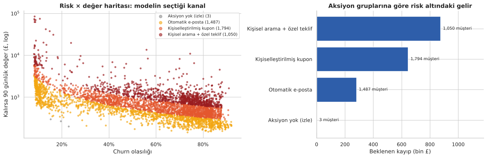
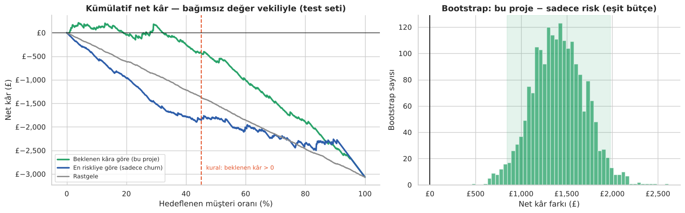

# Müşteri Kaybı, Müşteri Değeri ve Kampanya Optimizasyonu

Bu projede bir e-ticaret sitesinin işlem kayıtları üzerinden üç soruya cevap aramaya çalıştım: önümüzdeki 90 günde hangi müşteri gidecek, giderse ne kadar gelir kaybedilir ve elde sınırlı bir kampanya bütçesi varsa bu bütçe kime, hangi kanalla harcanmalı. RFM ve CLTV analizleri müşterinin bugün nerede durduğunu iyi anlatıyor; ben bunun bir adım ötesine geçip tahmini paraya çevirmek ve sonuçları güven aralıklarıyla raporlamak istedim.

Veriyi UCI Machine Learning Repository'deki [Online Retail](https://archive.ics.uci.edu/dataset/352/online+retail) setinden aldım. İngiltere merkezli bir hediyelik eşya sitesinin 01.12.2010 ile 09.12.2011 arasındaki yaklaşık 540 bin satırlık işlem kaydı. Notebook veriyi Databricks'in *Spark: The Definitive Guide* deposundaki aynı içerikli kopyadan kendisi indiriyor.



## Yaklaşım

Veriyi temizledikten sonra (iadeler, eksik müşteri ID'leri, teknik kalemler, aykırı değerler) bir gözlem penceresi ve onu izleyen 90 günlük bir tahmin penceresi tanımladım. Özellikleri yalnızca gözlem penceresinden üreterek sızıntının önüne geçtim. RFM'e ek olarak 20'den fazla davranışsal özellik çıkardım.

Churn için LightGBM kullandım, değer tarafında ise churn olasılığı ile Tweedie kayıplı bir harcama modelini birleştiren bir hurdle yapı kurdum ve bunu klasik BG-NBD × Gamma-Gamma CLTV ile karşılaştırıp ikisini karıştırdım.

Bir istatistik öğrencisi olarak en çok önem verdiğim kısım doğrulama oldu:

- Test müşterilerini en başta ayırdım. Hiperparametre seçimi ve model kıyasları yalnızca eğitim setinde, 5×5 tekrarlı çapraz doğrulamayla yapıldı; test setini en sonda bir kez açtım.
- Modeli bir dönemde eğitip hedef penceresi bittikten sonraki dönemde test ettim (3 farklı dönem). Böylece sadece aynı dönemde değil, ileriki bir zamanda da çalışıp çalışmadığını görebildim.
- Kampanya stratejilerini değer modeliyle sıralayıp yine aynı modelle puanlamak döngüsel olurdu. Bu yüzden kurtarılan müşterinin değerini modelden bağımsız bir vekille (geçmiş harcama hızı) ölçtüm, stratejileri eşit bütçeyle kıyasladım ve test setini 2.000 kez yeniden örnekleyerek %95 güven aralıkları hesapladım.

## Sonuçlar

| | Sonuç |
|---|---|
| Churn modeli (kilitli test) | ROC-AUC 0.74, PR-AUC 0.65 |
| Churn modeli (zamana dayalı testler) | ROC-AUC 0.745 – 0.768 |
| Değer modeli | R² 0.55 (hurdle 0.52, klasik CLTV 0.50, naif yöntem 0.37) |
| Risk × değer hedeflemesinin ek kârı | +£1.406 (%95 GA: £841 – £1.976) |
| Mevsim kalibrasyonu | Brier 0.208 → 0.200, AUC değişmeden |

Modelin en önemli özelliği müşterinin kaç farklı ayda alışveriş yaptığı çıktı; yani ne kadar harcadığından çok ne kadar düzenli geldiği önemli. Kendi alışveriş aralığının yaklaşık 3 katı süre sessiz kalan müşteri belirgin şekilde riskli bölgeye geçiyor.

Benim için en öğretici kısım kampanya simülasyonu oldu. Risk × değer kuralı, sadece riske göre hedeflemekten her değerlendirmede ve 2.000 bootstrap örneğinin tamamında daha iyi. Ama kampanyanın mutlak kârlılığı o kadar sağlam değil: muhafazakâr değer ölçüsüyle £10'luk kupon en iyi hedeflemeyle bile yaklaşık başa baş, kupon için ikna oranının en az ~%20 olması gerekiyor. Müşteri başına £1–5'lik ucuz kanallar ise makul her ikna oranında kâr getiriyor. Bu yüzden son karar mantığında her müşteriye kendi değerine uygun maliyette bir kanal seçtim.

Model zamanda genelleşiyor ama kalibrasyonu mevsime göre kayıyor: yazdan eğitilen model yılbaşı sezonunda churn'ü ~9 puan fazla tahmin ediyor. Bunu geçen yılın aynı dönemindeki "taze müşteri" kohortundan tahmin ettiğim bir log-odds kaydırmasıyla, sıralamayı bozmadan düzelttim.

Denediğim her şey işe yaramadı. Hiperparametre ayarı (+0.027 AUC) ve değer modelinde Gamma'dan Tweedie'ye geçiş (R² 0.36 → 0.52) belirgin fark yarattı. 8 yeni davranışsal özellik, monoton kısıtlar, lojistik regresyonla ensemble, BG-NBD özellikleri ve TF-IDF + SVD ile ürün zevk profili ise hiçbir şey değiştirmedi. 9 kesim tarihiyle veriyi çoğaltmak mevsimleri karıştırdığı için sonucu kötüleştirdi. BG-NBD'nin 9 aylık gözlemde kayıp parametrelerini sıfıra indirip herkesi aktif saydığını görmek de ilginçti.

Güç analizine göre kupon grubundaki ~1.800 müşteri, %15 ve üzeri ikna oranını bir A/B testiyle ölçmeye yetiyor; %10 gibi küçük etkiler için havuz yetmiyor.

Sonuçta `outputs/aksiyon_listesi.csv` dosyasında 4.334 müşteri için mevsime göre kalibre churn olasılığı, risk altındaki değer, SHAP'a göre ana risk nedeni ve beklenen kârı en yüksek iletişim kanalı yer alıyor.



## Çalıştırmak için

```bash
git clone https://github.com/Memreu/Customer-Churn-and-Value-Prediction.git
cd Customer-Churn-and-Value-Prediction
pip install -r requirements.txt
jupyter lab musteri_kaybi_ve_deger.ipynb
```

Notebook ilk çalıştırmada `data/retail.csv` dosyasını (~45 MB) kendisi indiriyor, tamamı birkaç dakikada çalışıyor. Python 3.13 ile denedim. GitHub büyük notebook'ları bazen gösteremediği için [nbviewer](https://nbviewer.org/github/Memreu/Customer-Churn-and-Value-Prediction/blob/main/musteri_kaybi_ve_deger.ipynb) üzerinden okumak daha rahat olabilir. [Colab](https://colab.research.google.com/github/Memreu/Customer-Churn-and-Value-Prediction/blob/main/musteri_kaybi_ve_deger.ipynb)'da çalıştırırken önce `!pip install -q shap lifetimes` gerekiyor.

## Eksikler

İkna oranları şimdilik varsayım; kampanyanın gerçek etkisini tasarladığım A/B testiyle ölçmek ve ardından uplift modellemeye geçmek istiyorum. Mevsim kalibrasyonu da tek bir geçmiş yıla dayanıyor, daha uzun bir veriyle mevsimselliği doğrudan modellemek daha doğru olur.

MIT lisansı ile paylaşıyorum. [LinkedIn](https://www.linkedin.com/in/memreu) · [Kaggle](https://www.kaggle.com/memreu)
